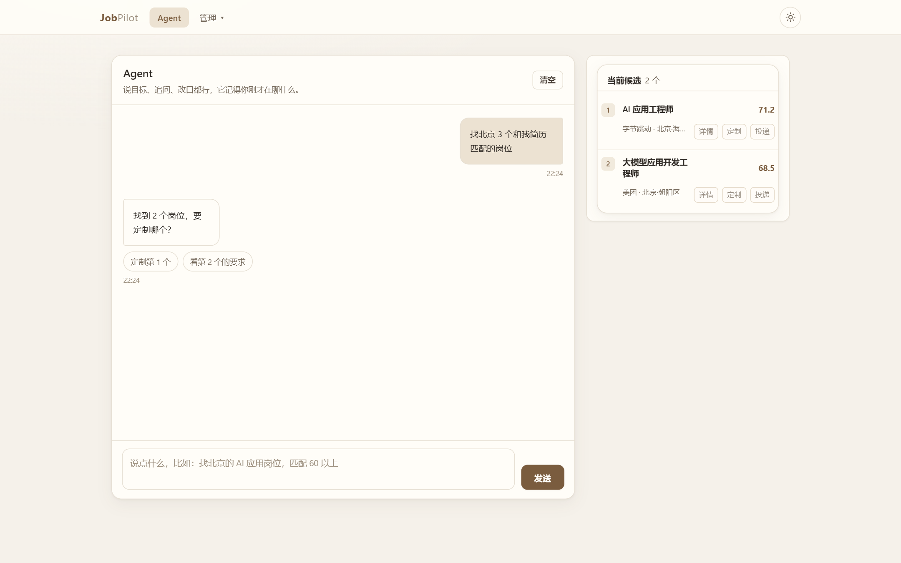
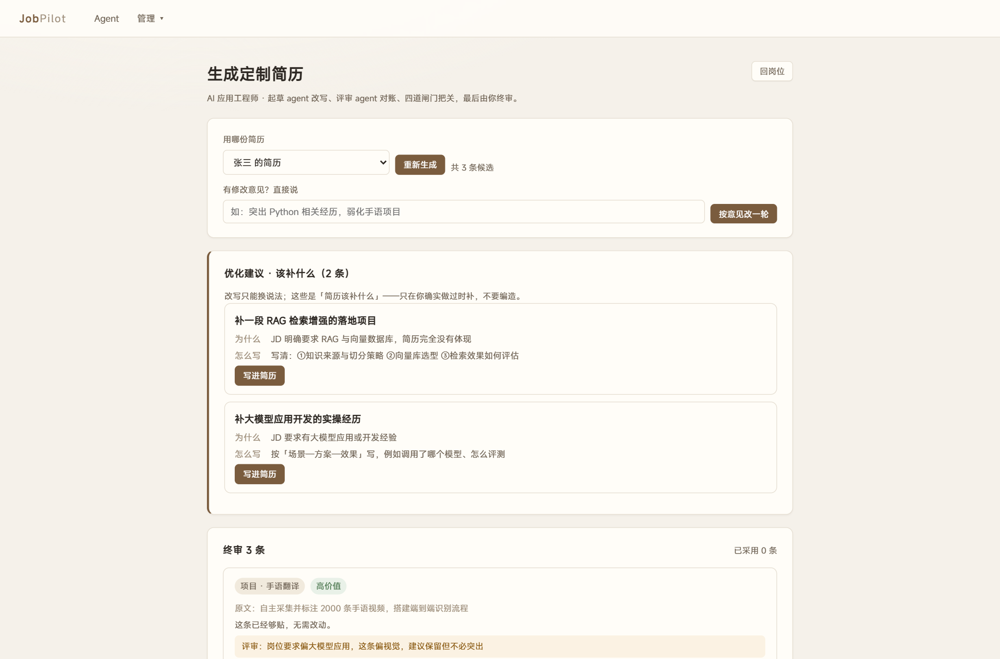
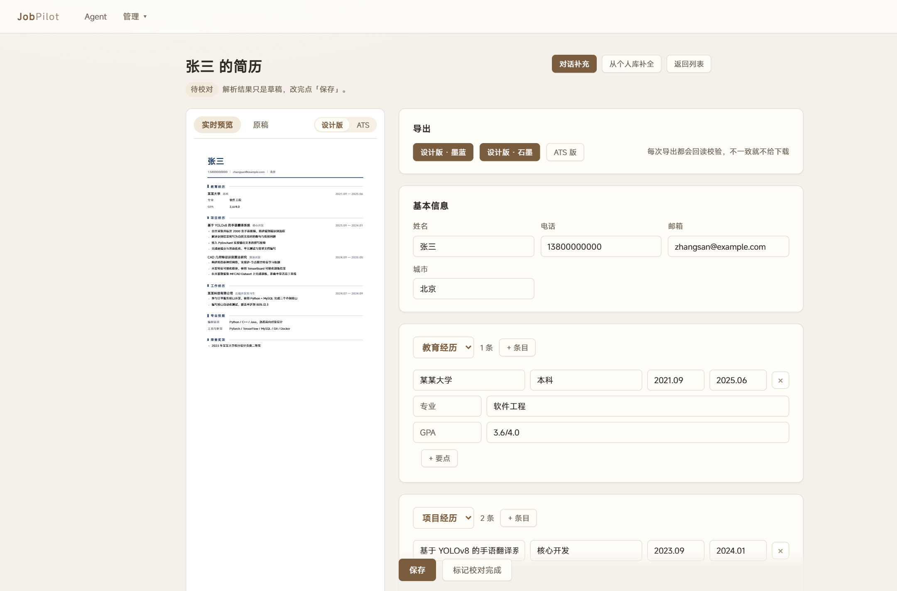

# JobPilot

[](https://github.com/natsuAtri/jobpilot/actions/workflows/ci.yml)

> 求职副驾 —— 本地运行的求职 Agent。
>
> 简历 PDF → 结构化校对 → 岗位搜索 → 匹配打分 → 双 agent 定制 → 半自动投递 → 复盘。
> 所有数据留在本机，模型可接任意 OpenAI 兼容接口。



## 它做什么

| 环节 | 能力 |
|---|---|
| **导入简历** | 解析任意版式 PDF：坐标级重建视觉行 → 规则骨架 → LLM 精修；逐项校对、对话答疑 |
| **导出简历** | 设计版（墨蓝/石墨）与 ATS 版双出口；导出后**回读校验**，字体映射错位就不给下载 |
| **找岗位** | 前程无忧关键词搜索（可翻页），自动去重，抓完整 JD |
| **匹配打分** | 项目对口 0.45 / 年限 0.25 / 方向 0.15 / 技能 0.10 / 语言 0.05，附语义证据 |
| **定制简历** | 双 agent：策略 → 起草 → 评审 → 三守恒闸门 → 人工终审；额外给「该补什么」的建议 |
| **投递** | 打开登录态浏览器到岗位页，最后一步人工点击；记录状态与跟进 |

**不做什么**：不识别扫描件、不自动提交投递（平台风控）、不编造经历、不做多用户。

## 截图

| 终审页（双 agent 产出） | 简历编辑（左侧实时预览） |
|---|---|
|  |  |

## 快速开始

> Python 版本：建议 3.12。项目自带的 `.venvlib` 是 cp312 编译的，
> 用别的版本会直接报错；`run.py` 现在会先检查版本并给出提示。

```bash
# 1. 依赖
python -m venv .venv
source .venv/bin/activate          # Windows: .venv\Scripts\activate
pip install -r requirements.txt
pip install -r requirements-rag.txt   # 可选：语义检索与精排（约 2.3GB 模型）

# 2. 配置模型
cp .env.example .env               # 填 RA_LLM_BASE_URL / RA_LLM_API_KEY / RA_LLM_MODEL

# 3. 启动
python run.py                      # 默认 http://127.0.0.1:8000
```

首次导入简历需要一份**有文本层的 PDF**（扫描件不行）。

> **不装 `requirements-rag.txt` 也能用**：语义证据与「项目对口度」会自动降级，
> 导入、编辑、导出、关键词匹配等其余功能不受影响。

### 语义匹配报 `'BertConfig' object has no attribute 'sub_configs'`

**依赖版本不匹配**：`sentence-transformers 6.x` 要求 `transformers >= 5.0`，
而当前环境里可能是 4.x（或两个 Python 环境的包被混用了）。

先自检，它会直接告诉你哪一项不对：

```bash
python tools/check_env.py
```

再在**启动应用的同一个环境**里升级：

```bash
pip install -U "transformers>=5.0,<6" "sentence-transformers>=6.0,<7"
```

> 不要混用两个 Python 环境。项目里的 `.venvlib` 只是兜底，和系统 Python 的包
> 混在一起就会触发这个问题；`run.py` 检测到混用时会打印警告。

### 装依赖慢？

pip 源慢就换镜像：

```bash
pip install -r requirements.txt -i https://pypi.tuna.tsinghua.edu.cn/simple
```

**不需要跑 `playwright install chromium`**——代码直接驱动系统里已有的 Chrome：

```python
p.chromium.launch(channel="chrome", headless=True)   # 或 channel="msedge"
```

只有在没有图形界面、也没装 Chrome 的服务器/CI 上才需要：

```bash
set PLAYWRIGHT_DOWNLOAD_HOST=https://cdn.npmmirror.com/binaries/playwright
playwright install chromium
```

## 技术要点

完整说明见 **[技术报告](docs/technical-report.md)**，这里只列三条最关键的：

**1. 简历解析是两段式**

```
PDF ──坐标级行重建──▶ 规则骨架 ──▶ LLM 精修 ──▶ 结构化 JSON
                          └── 失败/无模型 ──┘（自动回退）
```

规则负责确定性信号（章节词、日期、项目符号），模型补规则做不到的部分
（学位/专业拆分、装饰符号、版式歧义）。实测同一份简历：纯规则只切出 3 个章节、
姓名识别成「⚫ 民族：汉」；加精修后 6 个章节、姓名/学历/邮箱全对。

**2. 改写有闸门，机器管提醒、人管决定**

三守恒：数字、实体、责任强度、长度。任何一条不过就不会被采用。
这不只是为了防幻觉——更重要的是让「改写」可解释：每条都能看到原文、
改写、评审意见和拦截原因。

**3. 改写有天花板，补写才是增量**

不允许编造的前提下，「更贴 JD」只剩同义替换。所以双 agent 的真正产出是
「该补什么」的建议：JD 要但简历没体现的能力，给出补什么、为什么、怎么写。

## 项目结构

```
app/
  parse/      PDF → 结构化简历（坐标级行、规则、LLM 精修）
  render/     HTML 模板、Chromium 导出、回读校验
  match/      多维度打分、语义证据、方向一致性
  rag/        切块、bge embedding、BM25、RRF、rerank
  generate/   策略 / 起草 / 评审 / 三守恒 / 补写建议
  agent/      对话意图、会话状态、适配度判断
  dialogue/   解析答疑与 patch 应用
  routes/     FastAPI 路由
migrations/   15 个 SQL 迁移
tools/        21 个脚本（253 条断言）+ 意图/对话评测 + 夹具回放
docs/         技术报告 / 设计文档 / 改动日志 / 已知问题
```

## 验证

```bash
# 解析（需要一份有文本层的 PDF）
python tools/smoke_m1.py 你的简历.pdf        # 20 项

# 后续脚本需要先把简历导入数据库，用 resume_id 作为参数
python tools/smoke_m2.py 1                   # 渲染导出回读 15 项
python tools/smoke_match.py 1                # 打分 28 项
python tools/smoke_rag.py 1                  # 检索 7 项
RA_LLM_STUB=1 python tools/smoke_dialogue.py 1   # 对话补录 13 项
python tools/smoke_apply.py                  # 投递 13 项
python tools/smoke_search_personal.py        # 个人库 19 项
python tools/smoke_scratch.py                # 从零创建 10 项
RA_LLM_STUB=1 python tools/smoke_generate.py # 双 agent 13 项
python tools/smoke_agent.py                  # 路由 / 工具循环 / 检查点 / 注册表 124 项
python tools/smoke_agent_replay.py           # 夹具回放 5 项（CI 也跑这个）
```

合计 **253 条断言**。`RA_LLM_STUB=1` 启用 `app/llm/stub.py` 里的替身模型，
不需要 API Key 就能验通链路。

另有两个评测集：

```bash
python tools/eval_intent.py -v   # 30 条意图，离线，门禁式退出码
python tools/eval_agent.py -v    # 17 条对话，需要真实模型，验证工具选择
python tools/record_agent.py     # 用真实模型重录夹具（改了工具描述后跑一次）
```

### 维护

```bash
python tools/prune.py --dry-run   # 看会清理多少老数据
python tools/prune.py             # 清理（启动时也会自动跑一次）
```

`agent_trace` 留 7 天 / 5000 行，每个会话留最近 200 条消息，生成检查点留 7 天。
只清观测与日志，不动简历 / 岗位 / 投递记录。

## 开发

```bash
pip install -r requirements-dev.txt   # ruff + mypy
ruff check .                          # 静态检查
mypy --config-file pyproject.toml     # 类型检查（app/ 零错误）
```

CI 在每次 push 时自动跑 ruff + mypy + 不依赖模型/浏览器的测试；
`smoke_m2` / `smoke_scratch`（需要 Chromium 打印 PDF）与 `smoke_match` / `smoke_rag`
（需要 2.3GB 本地模型）只在本地跑。

改对话行为后请同步更新 `tools/eval_agent.py` 的用例，避免「改 A 坏 B」。

### Agent 路由

```
用户输入
  ├─ 精确指令（投/定制第 N 个、再找几个、排除 X、现在有什么…）→ 直接执行，0 次模型调用
  └─ 其余全部交给 agent：模型看「简历摘要 + 候选清单 + 最近 3 轮对话」，
     自己决定调哪些工具、调几次（最多 3 步）
```

定制简历与投递是**有副作用**的动作：agent 只能提议，用户回复「定制 N」「投 N」确认后才执行。
模型不可用时自动回退到规则解析。

## 平台限制（重要）

| 平台 | 搜索列表 | 岗位详情/投递 |
|---|---|---|
| 前程无忧 | ✅ 可自动化（含翻页） | ❌ 详情页触发滑动验证 |
| BOSS直聘 | 需登录，反爬强 | ❌ |

所以投递是**半自动**的：搜索、匹配、定制全自动；打开岗位页用登录态浏览器，
验证码和「投递」由你自己点，回来记录状态。

## 数据与隐私

- 所有数据在 `data/` 下（sqlite + 上传的 PDF + 导出件），已被 `.gitignore` 排除
- 简历只在本机处理，只有调用模型时才会把必要片段发给你的模型服务商
- `data/` 可直接打包备份

## 配置

模型统一在 `.env` 里配置，支持任意 OpenAI 兼容端点（DeepSeek / 通义 / Kimi / 智谱 / Ollama…）：

```env
RA_LLM_BASE_URL=https://api.deepseek.com
RA_LLM_API_KEY=sk-xxxxxxxx
RA_LLM_MODEL=deepseek-chat
```

改完 `.env` 需重启服务。

## 文档

- [技术报告](docs/technical-report.md) —— 架构、核心方案、实测数据、已知限制
- [设计文档](docs/design.md) —— 更细的数据模型与实现取舍
- [改动日志](docs/changelog.md) —— 逐轮改动记录
- [已知问题](docs/known-issues.md) —— 当前残留问题与调优记录

## 许可

[MIT](LICENSE)。依赖均为宽松许可：解析用 `pypdfium2`（BSD），未使用 AGPL 的 PyMuPDF。
