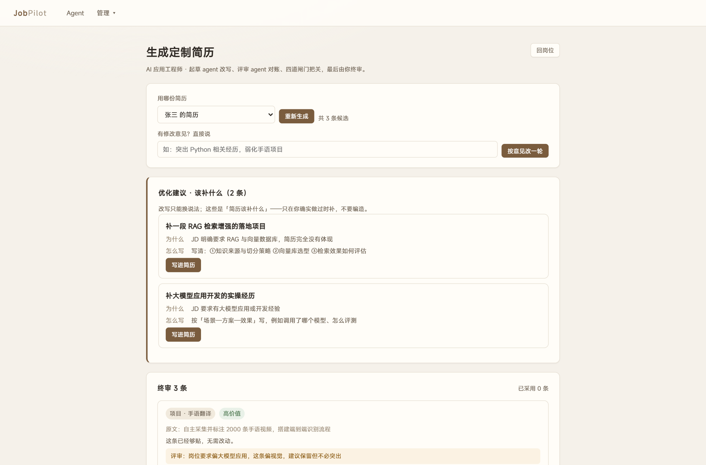
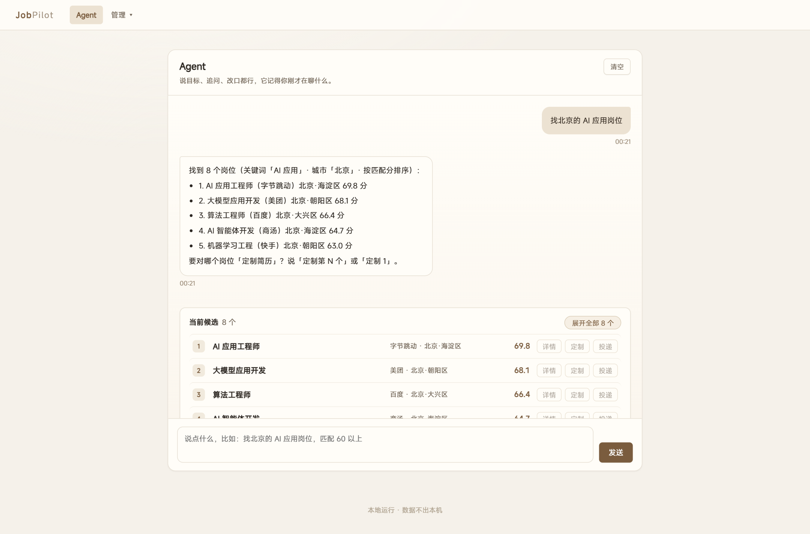
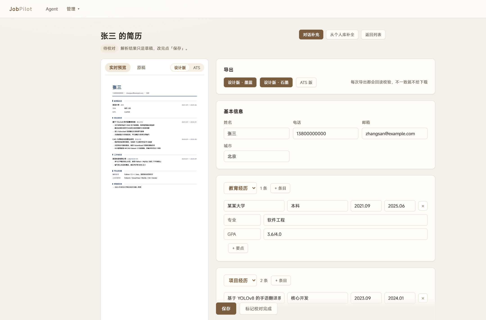

# JobPilot · 技术报告

> 一个本地运行、隐私优先的求职助手。本文记录关键设计决策、实测效果与已知限制，
> 面向想了解或复用这套方案的开发者。
>
> 代码量约 6.5k 行 Python，单机单用户，无云依赖（模型可接任意 OpenAI 兼容接口）。

---

## 1. 项目概述

### 1.1 要解决的问题

求职的真实流程是：读 JD → 判断自己够不够格 → 改简历 → 投递 → 跟进。
市面工具大多只做其中一段（简历模板、岗位聚合、自动投递），且普遍要上传简历到云端。

本项目把整条链路串起来，**全部在本地完成**：

```
导入 PDF → 结构化校对 → 匹配打分 → 对话式找岗 → 双 agent 定制 → 半自动投递 → 复盘
```

### 1.2 能力边界（先说清楚不做什么）

| 做 | 不做 |
|---|---|
| 解析任意版式的简历 PDF | 识别扫描件（无文本层） |
| 51job 关键词搜索 + 翻页 | 自动提交投递（平台反爬，需人工点最后一下） |
| 针对性改写简历措辞 | 编造没做过的经历 |
| 给出「该补什么」的建议 | 替你做职业规划 |
| 本地存储、单用户 | 多用户/权限/并发 |

---

## 2. 系统架构

### 2.1 分层

```
┌──────────────────────────────────────────────┐
│  Web 层   FastAPI 路由 + Jinja2 模板           │
│           /chat  /resumes  /jobs  /applications│
├──────────────────────────────────────────────┤
│  领域层                                        │
│   parse/    PDF → 结构化简历（规则 + LLM 精修） │
│   match/    多维度打分 + 语义证据               │
│   generate/ 双 agent 改写 + 三守恒闸门          │
│   agent/    对话意图、会话状态、工具调度         │
│   dialogue/ 解析答疑 + patch 应用               │
├──────────────────────────────────────────────┤
│  仓储层   sqlite3（自己写的薄封装，无 ORM）     │
├──────────────────────────────────────────────┤
│  外部适配 llm/（OpenAI 兼容）  search/（Playwright）│
│           rag/（bge + BM25 + rerank）          │
└──────────────────────────────────────────────┘
```

### 2.2 数据模型

```
profile ──1:1── personal_data（个人库，跨简历共享）
   │
   └─< resume ─< resume_section ─< resume_item ─< resume_bullet
                                                        │
job ─< match_result                                     │
 │                                                      │
 └─< generation_run ─< generation_item ─────────────────┘
                        （改写溯源到 bullet）
application ─< application_event
conversation ─< conversation_message
task_run（后台任务进度快照）
```

关键设计：**bullet 是最小单位**。改写、校验、溯源都以 bullet 为粒度，
所以「哪句话被改了、为什么被拦」永远查得到。

### 2.3 目录

```
app/
  main.py          应用入口、全局异常兜底
  config.py        .env 加载、路径
  db.py            连接、迁移
  models.py        Pydantic 领域模型
  parse/           pdf.py(坐标级行) rules.py(规则) refine.py(LLM 精修)
  render/          html.py context.py browser.py verify.py
  match/           scoring.py(打分) semantic.py(证据)
  rag/             chunk.py embed.py bm25.py fusion.py rerank.py
  generate/        strategy.py prompt.py engine.py guard.py suggest.py
  agent/           intent.py goal.py chat.py judge.py conversation.py
  dialogue/        疑点生成、patch 应用
  routes/          chat resumes jobs generate applications personal
migrations/        012 个 SQL 迁移
tools/             9 个 smoke 脚本（138 条断言）
```

---

## 3. 核心方案一：简历解析

### 3.1 为什么不能直接抽文本

简历的信息全在**版面位置**里：右对齐的日期、缩进的项目符号、分栏的技能。
`pdfplumber` 这类库按内容流顺序返回文本，对双栏和表格版式会读串行。

所以第一步是**用坐标重建视觉行**：

1. `pypdfium2` 取每个字符的 bounding box
2. 按垂直重叠聚类成行（重叠 > 较矮者高度的 45%）
3. 行内按 x 排序，间距超阈值切成 segment
4. 拉丁字符之间按间距补空格，CJK 不补

得到的是 `y | 字号 | x:文本 | x:文本` 的紧凑表示——**同一行的多个 x 就是不同列**。

### 3.2 两段式：规则搭骨架，模型补结构

```
PDF ──坐标级行──▶ 规则解析 ──粗略骨架──▶ LLM 精修 ──▶ 结构化 JSON
                      │                      │
                      └── 失败/无模型 ────────┘（回退）
```

**规则层**负责确定性信号（不花 token）：

- 章节标题词典（教育/工作/项目/技能/获奖/证书/其他，含同义词）
- 日期区间正则（`2023.09 — 2024.01`、`至今`）
- 项目符号（`• · ▪ ➢ ➤ ▸ ► ⚫` 等 15 种）
- 联系方式（邮箱/电话/链接）
- 姓名：按 segment 取「字号最大的 2–4 个汉字」，排除「个人简历」等标题词

**LLM 精修**负责规则搞不定的部分：把带坐标的视觉行和规则骨架一起给模型，
输出结构化 JSON，按 schema 校验后覆盖；失败就保留规则结果。

### 3.3 实测：同一份机械专业简历

| 项目 | 纯规则（修复前） | 规则 + LLM 精修 |
|---|---|---|
| 姓名 | `⚫ 民族：汉` ❌ | `张三` ✅ |
| 章节数 | 3 个（漏了教育/竞赛/技能） | 6 个 ✅ |
| 学历 | 缺失 | 某海外高校 · 硕士（在读）· 机械工程 · GPA --/100 |
| 邮箱 | 丢失 | `zhangsan@example.com` ✅ |
| 竞赛条目 | 粘成一坨 | org/role/日期/7 条要点全部就位 |

> 邮箱的点号在 PDF 文本层里是图形而非文字，规则抓不到，是模型从上下文还原的。

### 3.4 踩过的坑

- **装饰性标点污染标题**：`教育背景 . . .` 超出长度上限导致识别失败 → 分类前先剥离 `.` `·` `|`
- **全局左边界**：整篇取最小 x，会把「整体缩进」的章节里所有行判成 bullet → 改为每章节单独算
- **字间距伪空格**：`2021 .09`、`1 00` → 加 `_tighten()` 收紧数字/日期/中文之间的空白
- **续行合并**：bullet 后的缩进续行要合并，但「标题 + 右对齐日期」不能合并 → 用「上一行是否 bullet + 对齐位置」区分

---

## 4. 核心方案二：匹配与语义检索

### 4.1 打分维度（按「项目对口优先」重排）

| 维度 | 权重 | 计算方式 |
|---|---|---|
| **项目对口** | 0.45 | JD 每条要求能否被简历里的某条经历接住（embedding 取最大相似度后平均） |
| 年限 | 0.25 | 简历年限 vs JD 要求，缺一年扣一档 |
| 方向一致性 | 0.15 | 简历整体方向 vs 岗位方向的语义相似度 |
| 技能覆盖 | 0.10 | 关键词命中（核心技能 vs 泛技术词） |
| 语言证书 | 0.05 | 四六级/托福/雅思 |

**为什么这样排**：早期版本技能占 0.45，结果「设备工程师」岗因为 JD 里写了
「熟悉 Python 者优先」就能拿 100 分。会几门语言不说明问题，**做过的项目对不对口才是关键**。

### 4.2 实测效果（同一份 AI 方向简历）

| 岗位 | 旧分（技能主导） | 新分（项目主导） |
|---|---|---|
| AI 应用（RAG/向量库） | 100 | 69 |
| 设备工程（含「熟悉 Python 优先」） | 100 | 58 |
| 财务（用友/金蝶） | 0 | 12 |

分数整体下移，不再虚高；跨领域岗位被压到 60 以下。

### 4.3 语义证据：三轮迭代

目标是回答「JD 的哪条要求，被简历的哪条经历接住了」。

| 版本 | 方案 | 问题 |
|---|---|---|
| v1 | embedding 余弦 + 阈值 | 无关配对也能过 |
| v2 | + bge-reranker-base | 分数是压缩 logit，难校准；MySQL 仍被配给 OCR |
| v3 | **bge-reranker-v2-m3** | 概率尺度（相关 0.07~1.0，无关 0.001~0.01），阈值 0.05 |

v3 实测（JD：MySQL / RAG / 计算机视觉）：

```
✅ JD「熟悉 MySQL 等数据库」→ 简历「掌握 MySQL 数据库」 0.801
   JD「有 RAG 经验」        → 无证据（简历确实没有）
   JD「计算机视觉项目」      → 无证据
```

**关键不是「配得更准」，而是「敢于不配」**——早期版本硬凑证据，会误导后续改写。

### 4.4 检索链路

```
简历 → 按章节/条目切块（每块带上下文标签）
     ├── bge-small-zh 向量召回
     └── 手写 BM25（CJK bigram）
          └── RRF 融合 → rerank 精排 → 取 top-k
```

RRF 融合不需要调权重，对两路分数量纲不敏感，是本地小规模场景的省心选择。

---

## 5. 核心方案三：双 agent 定制简历

### 5.1 流程

```
事实白名单（bullet + 数字 + 实体 + 强度）
        │
   ① 策略 agent：这次重点改哪几条、为什么、你的短板
        │
   ② 起草 agent：只改策略点名的条目
        │
   ③ 评审 agent：逐条判断 ok / edit / 仅措辞 + 漏改项
        │
   ④ 三守恒闸门：数字 / 实体 / 强度 / 长度
        │
   ⑤ 补写建议：JD 要但简历没体现的，给「补什么、为什么、怎么写」
        │
   ⑥ 终审页：机器排序，人来拍板
```

### 5.2 三守恒闸门

改写的风险是「越改越像那么回事，但其实在编」。闸门做四件事：

| 检查 | 规则 |
|---|---|
| 数字守恒 | 改写后不得出现原文没有的数字 |
| 实体守恒 | 不得新增拉丁词、机构名 |
| 强度守恒 | 「参与」不能变「负责」，「负责」不能变「主导」 |
| 长度约束 | 不超过原文 1.25 倍（短条目留 +6 字余量） |

任一不过 → 标记「被拦截」，终审页显示原因，且不能采用。

### 5.3 关键领悟：改写有天花板

实测下来，三守恒允许的「更贴 JD」只剩同义替换（构建→搭建、进行→开展），
评审给的价值判断几乎全是「仅措辞」。这是**设计使然**，不是缺陷：

> 不允许编造的前提下，简历能提升的空间主要不在措辞，而在**补内容**。

所以双 agent 的真正产出是第 ⑤ 步的「补写建议」，改写只是顺带的措辞润色。

### 5.4 实测：终审页



- 上方「优化建议 · 该补什么」：拿 JD 和简历比对，指出缺什么
- 下方「终审」：逐条改写，标「高价值 / 仅措辞 / 被闸门拦截」
- 每条带评审意见，可手动改文本

### 5.5 踩过的坑

- **修订轮吃掉合格改写**：评审让改，第二轮起草把已经合格的改写成违规的 → 改为「修订不覆盖已通过的条目」
- **LLM 爱加从句**：`构建图卷积神经网络` → `设计并构建…，完成模型结构设计与算法选型`（长度 2 倍）→ 白名单每条标字数上限 + prompt 给正反例
- **评审说「没收益」就自动还原**：用户可能就想用这个措辞 → 改为只标「仅措辞」，不自动撤销

---

## 6. 核心方案四：对话 agent

### 6.1 意图识别：规则优先，模型兜底

```
规则命中 → 直接执行（0 成本，覆盖 90% 常见说法）
   │ 未命中
   └──▶ LLM 分类（便宜档，输出 intent + 参数）→ 执行
          │ 仍失败
          └──▶ 帮助文案
```

覆盖意图：找岗位 / 再找几个 / 排除 / 问简历建议 / 定制 / 投递 / 问岗位详情 / 判断适合度 / 查候选 / 闲聊。

**为什么不全用 LLM**：本地应用，每次交互都调模型既慢又贵；
规则能覆盖绝大多数表达，模型只兜长尾。

### 6.2 会话状态

- `conversation` + `conversation_message` 持久化，重启不丢
- 候选列表存在会话 state 里，支持「第 2 个」「这个」指代
- 显式序号（`第 N 个`）优先于列表顺序，避免「用了又排序」导致指代错位

### 6.3 实测：Agent 页



- 回复用结构化排版（编号列表、加粗小标题）
- 候选缩略行：序号 / 标题 / 公司地点 / 分数 / 操作，默认 5 条可展开
- 慢操作有明确文案（「正在搜索岗位并匹配打分…约 10–30 秒」）

---

## 7. 工程实践

### 7.1 导出回读校验

Chromium 生成 PDF 时，某些中文字体的 ToUnicode 映射会写错码位——
Noto Sans SC 会把「工」「大」写成康熙部首 `U+2F27`/`U+2F24`，
ATS 读出来是「西北⼯业⼤学」，关键词直接失配。

肉眼看不出来，所以导出后**把 PDF 再读一遍，和源文本逐段比对**，不一致就不给下载。
这是 ATS 版简历能用的前提。

### 7.2 后台任务进度落库

搜索/生成跑在后台线程，进度写进 `task_run` 表：

- 重启后页面还能看到上次结果，而不是白屏
- 启动时把上次未完成的任务标记为「已中断」，避免永远转圈

### 7.3 模型配置

统一走 `.env`（`RA_LLM_BASE_URL` / `RA_LLM_API_KEY` / `RA_LLM_MODEL`），
任何 OpenAI 兼容接口都能接。任务分了 `strong` / `cheap` 两档，
以后想接两档模型时不用改业务代码。

### 7.4 测试体系

9 个 smoke 脚本，**138 条断言**，全部跑在 `RA_LLM_STUB=1` 下（不依赖真实模型）：

```
smoke_m1   解析（20）      smoke_m2   渲染导出（15）
smoke_match 打分（28）     smoke_rag  检索（7）
smoke_apply 投递（13）     smoke_search_personal 个人库（19）
smoke_dialogue 对话补录（13） smoke_scratch 从零建（10）
smoke_generate 双 agent（13）
```

每个脚本独立可跑，退出码非零即失败，可直接挂 CI。

### 7.5 前端

- 服务端渲染 + 少量原生 JS，无前端构建链
- 全局暖纸主题（`theme.css` 覆盖层，不改结构）
- 简历编辑页左侧**实时预览**：HTML 渲染 + 按容器宽度缩放，改完保存即更新



---

## 8. 效果评估

### 8.1 实测汇总

| 环节 | 指标 | 结果 |
|---|---|---|
| 解析 | 6 个章节、姓名/电话/邮箱/学历全对 | ✅ |
| 匹配 | 跨领域岗位分数 | 100 → 58（设备）、12（财务） |
| 证据 | 无关要求是否硬凑 | 不再硬凑（RAG/CV 正确留空） |
| 双 agent | 改写通过闸门 | 3–5 条/次，0 条拦截（修完后） |
| 导出 | 回读一致性 | 100%（2 页内） |
| 测试 | 断言 | 138 条全绿 |

### 8.2 已知限制（诚实清单）

| 限制 | 影响 | 现状 |
|---|---|---|
| 扫描件不支持 | 无文本层的 PDF 无法解析 | 明确报错，不静默失败 |
| 平台反爬 | 自动投递只能到「打开浏览器」 | 半自动，人点最后一下 |
| 改写价值有限 | 不允许编造 → 只能同义替换 | 用「补写建议」补足 |
| 通用软件岗分数偏高 | 简历里有通用的「前端/测试」bullet | 建议用户精简无关条目 |
| LLM 间歇失败 | 判断/建议偶尔为空 | 网络重试 + JSON 重试 |
| 单页模板 | 内容多会顺延 2 页 | 已允许 2 页，>2 页提示精简 |
| 无并发设计 | 单用户 | 本地应用，不需要 |

---

## 9. 设计取舍

| 决策 | 选择 | 理由 |
|---|---|---|
| 存储 | sqlite3 + 手写薄封装 | 单机单用户，ORM 是负担 |
| 检索 | bge + BM25 + RRF | 小规模场景不需要向量库 |
| 改写校验 | 确定性规则而非 LLM | 校验必须可复现、不花钱 |
| 意图 | 规则优先 + 模型兜底 | 90% 说法规则够用 |
| 解析 | 规则 + LLM 精修 | 规则快且稳，模型补长尾 |
| 投递 | 半自动 | 平台风控，强攻无意义 |
| 前端 | 服务端渲染 | 无构建链，开源友好 |

---

## 10. 后续路线

| 优先级 | 事项 | 说明 |
|---|---|---|
| P0 | 意图继续补 | 「简历和这个岗位差在哪」这类对比型问题 |
| P1 | 多简历管理 | 现在同类简历只存一份 |
| P1 | 投递跟进提醒 | 投递后 N 天没回音主动提醒 |
| P2 | 技能加权 | 区分「核心要求」和「优先项」，进一步压标题党岗位 |
| P2 | 移动端适配 | 目前只考虑了桌面 |
| P3 | 多平台搜索 | 目前只有 51job |

---

## 附：快速开始

```bash
pip install -r requirements.txt        # 依赖装进 .venvlib
cp .env.example .env                   # 填 base_url / api_key / model
python -m uvicorn app.main:app --port 8099
# 打开 http://127.0.0.1:8099
```

模型首次使用会自动缓存：`bge-small-zh-v1.5`（~180MB）+ `bge-reranker-v2-m3`（~2.1GB）。

---

*本文档与代码同步维护，改动记录见 [`changelog.md`](changelog.md)，已知问题见 [`known-issues.md`](known-issues.md)。*
